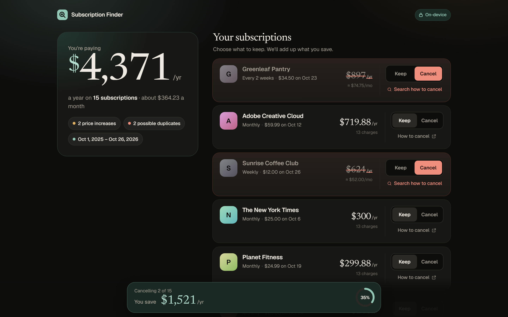
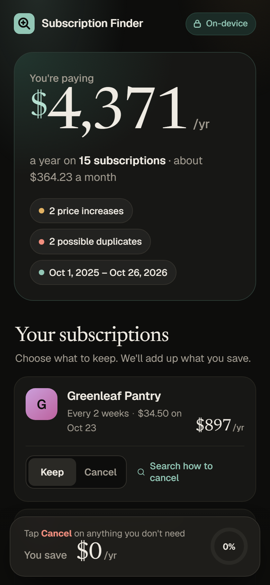

# Subscription Finder

Drop in a bank or card statement (CSV) and see every recurring charge: merchant, cadence, last amount, **yearly cost**, flags for price increases and duplicates, and an official cancel link. Mark each one Keep or Cancel and the "You save $X/yr" total updates live.





Built by a [KrewBots](https://krewbots.com) agent. Free and open source under the [MIT licence](LICENSE).

## Privacy

**Everything stays in your browser.** The statement is read with the File API and analysed in memory. Nothing is uploaded, stored on a server, tracked or sent to a third party. There are no accounts, cookies or analytics. A strict Content Security Policy (`default-src 'self'; connect-src 'self'; ...`) stops the page from contacting any other server. The Node server sends it as an HTTP header, and `index.html` repeats it in a `<meta>` tag, so static hosting is covered too. Fonts are bundled locally.

Cancel links open the service's own site in a new tab, only when you click one.

## Run it

```bash
npm start            # http://localhost:4173  (PORT=5000 npm start to change)
```

There are no runtime dependencies. Node 20+ is the only requirement. Or open it on any static host (see [GitHub Pages](#github-pages)). Tap **Try with a sample statement** to load a fictional 13-month statement (15 subscriptions, $4,371/yr, 2 price increases and Disney+ billed twice) without using real data.

## Test it

```bash
npm ci                              # dev dependency: Playwright
npx playwright install chromium     # once
npm test                            # 50 unit tests: parsing, the 4 banks' 7 layouts, detection edge cases, cancel-link evidence, count-up math
npm run test:e2e                    # Playwright (Chromium) at 390px, 1440px and a 1080x1920 frame, plus a frame-by-frame no-negative count-up check
npm run test:pages                  # builds dist/ and runs the same e2e suite against a GitHub Pages-like preview
SCREENSHOT_DIR=/path npm run test:e2e   # where screenshots go (default test-results/, git-ignored)
```

The e2e suite loads the sample, uploads every bank fixture, runs the column-mapping fallback and PDF rejection, and toggles Keep/Cancel while checking the savings total. It fails on any console error, or on any request that leaves the page's own origin.

## GitHub Pages

The app is plain static files, so it runs on GitHub Pages without the Node server.

```bash
npm run build:pages      # copies public/ to dist/ and checks it is Pages-safe
npm run preview:pages    # serves dist/ at http://localhost:4175/subscription-finder/ with no custom headers
```

`build:pages` refuses to build if the `<meta>` CSP is missing or differs from the server's CSP, or if any file uses a root-absolute URL (`/x`), which would break under a project subpath like `/subscription-finder/`.

Pages can't send custom HTTP headers, so on Pages:
- the CSP comes from the `<meta>` tag. Every directive applies except `frame-ancestors`, which browsers ignore in `<meta>`, so the page can be framed by another site. The page holds no secrets or account actions, so this is low risk.
- `Referrer-Policy` comes from `<meta name="referrer" content="no-referrer">`.
- `X-Content-Type-Options`, `Permissions-Policy` and `Cross-Origin-Opener-Policy` are not sent. GitHub Pages serves correct MIME types and the app asks for no permissions.

`.github/workflows/pages.yml` deploys `dist/` and only runs when started by hand (Actions > Deploy to GitHub Pages > Run workflow). Enable Pages with source "GitHub Actions" in the repository settings first.

## How it works

| File | What it does |
|---|---|
| `public/lib/csv.js` | RFC 4180 parser; finds the header row (skips Bank of America's summary preamble); detects the bank layout; normalises signs so money spent is positive; handles generic headers; produces the column-mapping fallback. |
| `public/lib/merchants.js` | Normalises merchants: strips processor prefixes (`SQ *`, `TST*`, `PAYPAL *`, `PADDLE.NET*`, `Debit Card Purchase -`, …), store numbers, reference codes, phone numbers and state codes, and matches known services. |
| `public/lib/detect.js` | Groups charges by merchant and classifies cadence (weekly, every 2 weeks, monthly, quarterly, yearly) with per-interval tolerance and one allowed skipped period. It requires a stable price, so groceries don't count. Splits parallel series (the same service on two billing days, or two plans on one day). Flags price increases, duplicates and music/storage overlaps. Reports subscriptions that stopped months ago separately and leaves them out of the total. |
| `public/lib/countup.js` | Count-up math for the animated numbers. Progress is clamped to [0, 1] because a frame's timestamp can predate the animation's start. |
| `public/lib/services.js` | **Generated** list of 69 services whose official cancel/manage URL was verified. |
| `public/app.js`, `index.html`, `styles.css` | Mobile-first UI: scan animation, count-up yearly total, staggered reveal, Keep/Cancel toggles, sticky savings bar with a progress ring. Honours `prefers-reduced-motion`. |
| `server.mjs` | Tiny static server that adds the CSP and other security headers. |
| `scripts/build-pages.mjs`, `scripts/pages-preview.mjs` | GitHub Pages build and a local preview that mimics Pages (subpath, no custom headers). |

### Supported statement formats

| Bank | Header row | Sign convention |
|---|---|---|
| Chase credit card | `Transaction Date,Post Date,Description,Category,Type,Amount,Memo` | purchases negative |
| Chase checking | `Details,Posting Date,Description,Amount,Type,Balance,Check or Slip #` | withdrawals negative (rows may have a trailing comma) |
| Bank of America checking | summary block, then `Date,Description,Amount,Running Bal.` | withdrawals negative; quoted `"1,234.56"`; "Beginning balance" pseudo-row skipped |
| Bank of America credit card | `Posted Date,Reference Number,Payee,Address,Amount` | purchases negative |
| American Express | `Date,Description,Amount`, or the 13-column "all additional details" export | charges **positive**; multi-line Extended Details handled |
| Capital One credit card | `Transaction Date,Posted Date,Card No.,Description,Category,Debit,Credit` | separate Debit/Credit columns; ISO dates |
| Capital One 360 | `Account Number,Transaction Description,Transaction Date,Transaction Type,Transaction Amount,Balance` | unsigned amounts plus a `Debit`/`Credit` type; `MM/DD/YY` |
| Anything else | auto-mapped from header names, otherwise a column-mapping screen | the user picks the columns and the sign style |

PDF statements are not supported. Text extraction from bank PDFs isn't reliable enough, so the app explains how to download a CSV instead.

**Sources for the header formats.** None of the four banks publishes its CSV columns on an official help page, so these come from open-source importers and parsers built against real exports:
- Chase: [hone import.rs](https://github.com/heskew/hone/blob/main/crates/hone-core/src/import.rs), [breadbox templates.go](https://github.com/canalesb93/breadbox/blob/main/internal/provider/csv/templates.go), [oyamel csv.test.ts](https://github.com/Wolfe1/oyamel/blob/main/tests/csv.test.ts), [nigel importers.md](https://github.com/madebyraygun/nigel/blob/main/docs/importers.md)
- Bank of America: [go-ynabler bofa.go](https://github.com/mschilli/go-ynabler/blob/master/bofa.go), [go-ynabler bofacc.go](https://github.com/mschilli/go-ynabler/blob/master/bofacc.go), [legion bofa_activity.py](https://github.com/kevinmyo-code/legion/blob/main/server/ingest/parsers/bofa_activity.py)
- American Express: [hone import.rs](https://github.com/heskew/hone/blob/main/crates/hone-core/src/import.rs), [safe-to-spend amex.py](https://github.com/carolinaporto/safe-to-spend/blob/main/backend/importers/amex.py), [Finaloop: Amex CSV export](https://help.finaloop.com/en/articles/9582937-american-express-how-to-upload-your-csv-bank-statements)
- Capital One: [beancount.io Capital One CSV](https://beancount.io/tools/csv-to-beancount/capital-one), [foxy-balance parser tests](https://github.com/nozzlegear/foxy-balance/blob/master/tests/FoxyBalance.Sync.Tests/CapitalOneTransactionParserTests.fs), [moneypit parsers.py](https://github.com/tomthehare/moneypit/blob/main/parsers/parsers.py)

Some details are still unconfirmed against a real export: the Amex detailed-export date format (`MM/DD/YY` vs `MM/DD/YYYY`; both are accepted) and the sign of Bank of America credit-card payments (sources conflict; payments and refunds are ignored either way because only money out is analysed).

## Cancel links: how they're verified

`npm run verify-links` (`scripts/verify-links.mjs`) takes every candidate in `data/services.candidates.json` and fetches it. It tries a plain HTTPS GET first, then real headless Chromium for sites that block scripts. A URL passes only if all of these hold:
- it ends on HTTP 2xx, on the service's own domain;
- it isn't a "not found" page or bounced to the home page;
- its title or path is actually about cancelling or managing a subscription.

Every attempt, status, final URL and page title is written to `data/cancel-links-verification.json` with the check date. Only passing services are written to `public/lib/services.js`. Two URLs that passed the automatic check were rejected after a manual title review (a Max page listing providers and a generic Amazon Prime benefits page) and replaced with real cancellation articles. Those rejections are recorded in the evidence file too.

Last run, **2026-10-28: 69 verified, 5 dropped** (WSJ, Peloton, Twitch, Crunchyroll, Zoom: no official page could be proven). Merchants without a verified link get a "Search how to cancel" DuckDuckGo query. URLs are never invented.

Note: Planet Fitness has no online cancellation, so its link is the official customer-service/FAQ page, which explains the in-club and mail process.

## Fixtures

`npm run fixtures` (`scripts/make-fixtures.mjs`) deterministically regenerates `public/sample-statement.csv`, `test/fixtures/*.csv` and `test/fixtures/expected.json`. All names, merchants like "Ironhaus Gym" and "Sunrise Coffee Club", accounts and amounts are fictional.

## Licence

MIT, see [LICENSE](LICENSE). Bundled fonts are under the SIL Open Font License; see [THIRD_PARTY_NOTICES.md](THIRD_PARTY_NOTICES.md).
